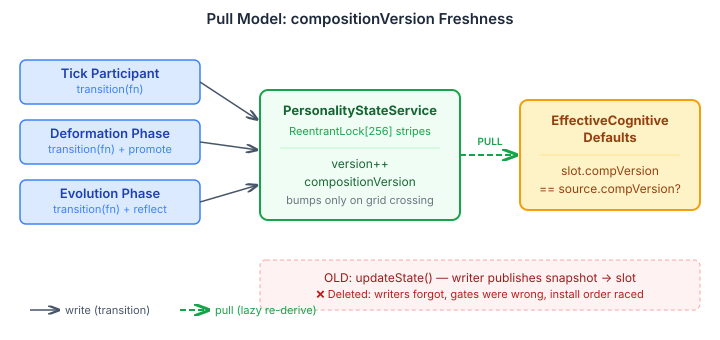

# The pull that replaced the push

Continues from [The design that designed itself](2026-11-18-mdp01-the-design-that-designed-itself.md).

The design session left me with a 14-task plan across 6 batches. No code. This session implements the first four batches — the foundation that makes personality evolution actually work.

## The dead propagation path

The original `EffectiveCognitiveDefaults` used a push model. When personality state changed, the writer called `updateState()` to publish a snapshot. Two callers, two threads, no coordination. And both had the same defect: they gated the publish on a "is it worth publishing" check that was wrong.

`SituationalPersonalityParticipant` checked `isDirty` — whether any facet offset exceeded an epsilon. When displacement decayed below the threshold, it stopped publishing. The slot kept the last published value forever. An idle agent's personality got frozen at whatever displacement happened to be the last one above ε.

`SituationalDeformationPhase` checked `facetsWithDrift > 0`. Same problem, different threshold. When no facets were drifting, the phase stopped publishing, and the slot never learned about promotions or ledger changes from the same run.

Both defects existed because push makes correctness depend on every writer remembering to publish. The two writers didn't coordinate, and neither caught the other's omission.

## Why pull

Under pull, nobody publishes. `PersonalityStateService.transition()` is the sole mutation path. It increments a `compositionVersion` counter whenever the composed view changes — that is, whenever the facet offsets cross a quantised grid line or the lived profile changes. `EffectiveCognitiveDefaults` treats a slot as fresh only while both its `baseVersion` (from the Eidos descriptor) and its `compositionVersion` match the source. A stale slot re-derives from the persisted state at its next read.

The quantisation is the key. A naive version counter that bumps on every `transition()` would make every ticking agent stale on every tick. The participant persists on every tick — that's hundreds of transitions per agent per hour. The composition key instead projects each facet's `promoted + homeOffset` onto a grid of `EPSILON_PUBLISH` (0.005) width. Slow drift below the grid stays invisible. The first grid crossing triggers re-derivation. This is strictly better than the old push: no quiescent agent is ever re-derived, and no active agent waits for a publisher that forgot to call.



## Striped locking

`PersonalityState` now has two concurrent writers — the tick participant and the consolidation phase — plus the signal recorder reading it. The spec (#1088) had already identified the TOCTOU: `persist` was a blind write that could overwrite a concurrent `transition`.

The fix is a fixed `ReentrantLock[256]` array indexed by `TenantAgentKey.hashCode()` spread. Every write goes through `transition(tenantId, agentId, now, fn)` which acquires the stripe, loads the current state, applies the pure function, increments the version, and persists — all under the lock.

Two properties make this work:

**No eviction.** The lock array is fixed and never shrinks. A per-entry map with eviction can hand out two lock objects for the same key if one is evicted while another thread holds a stale reference. With 256 stripes and typical agent populations in the tens, false sharing between agents in one stripe costs at most one short critical section.

**No nesting.** No code path holds two stripes. The transition function `fn` never touches another agent. The consolidation phase calls the signal writer outside the personality state lock. This keeps the stripe contention window short — a MindMap node read plus a property write.

## PID-5 promotion: personality that survives a restart

The PID-5 integrator already tracked `homeOffset` — a slow drift that decayed back toward zero over 180 days. What it never did was graduate persistent offset into the identity baseline. An agent whose emotional landscape had genuinely shifted would lose that shift to setpoint decay.

Promotion is the missing step. When `|homeOffset|` stays above `promoteFraction × dMax` (default 0.08) for `promoteDwell` (30 days), the phase moves the offset into `promoted`:

```java
delta = clamp01(baseline + promoted + homeOffset) - (baseline + promoted);
// then: homeOffset -= delta, promoted += delta, saturatedSince := null
```

The resting score `baseline + promoted + homeOffset` is unchanged by the operation. It's an accounting move, not a personality change. But `promoted` doesn't decay. After a restart, `homeOffset` is zero (it decays). But `promoted` is still there. The agent's personality survived.

The budget cap (`promotionBudget = 0.20`) prevents unbounded lifetime drift. Without it, re-saturation after each promotion would allow an agent's anxiety to drift arbitrarily far from its authored baseline over years of operation.

## What matters and what's next

Personality evolution matters for autonomous agents because static identity is a lie. An agent that has been in stressful interactions for months should behave differently from one that hasn't — not because we tell it to, but because the same mechanism that makes humans adapt to their environment operates on the same timescales. PID-5 facet promotion is the first mechanism that makes this real: a personality change that persists across restarts, that is bounded by design, and that composes cleanly over re-authored baselines.

The remaining two batches implement the JPAF side — Jungian function profile evolution through the Eidos evaluation SPIs, with the full state machine for reflection, recovery, epoch tracking, and the reversal detection that prevents oscillation. The foundation is in place: the transition API, the pull model, and the signal writer. What's left is the evaluation logic.
