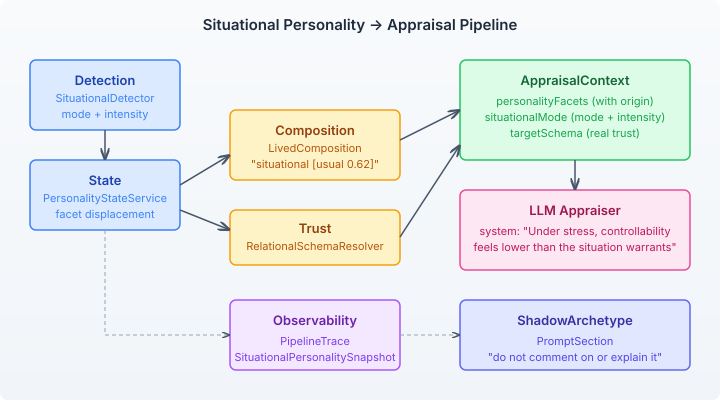

The situational personality system has been running for weeks. Facets shift. Cognitive defaults adjust. The LLM appraises situations through modified PID-5 scores. All implicit. All invisible to the appraiser itself.

The problem is subtle: a character under stress has elevated Anxiousness (0.77, up from a baseline of 0.62), and the LLM appraiser sees `Anxiousness (0.77)` in its prompt. It has no way to know whether 0.77 is this character's natural state or a temporary spike. It appraises accordingly — as if the character has always been this anxious. The felt quality of the emotion is correct in magnitude but wrong in kind. There is a difference between a character who is constitutionally anxious and one who is anxious right now because of what happened.

## The origin that tells a story

The fix starts at `LivedComposition`. When situational modulation shifts a facet beyond the publish threshold (0.005), the origin field now carries the baseline:

```
Anxiousness (0.77): situational [usual 0.62]
```

Three words and a number. The LLM appraiser gets exactly the information it needs: this is not who the character is, it is where the character is right now. The gap between 0.77 and 0.62 is the story — recent experience reshaping disposition in this moment. The appraiser can let that gap colour the felt quality: not constitutional dread, but heightened alertness with a clear before-state.

A `Locale.ROOT` format ensures the decimal point survives non-English JVM locales. The kind of bug you catch on code review or discover six months later in production, never anything in between.

## Giving the appraiser context

The origin string handles the passive case — the appraiser reads facet scores and infers from the annotation. But the CARMA pipeline also needs to know the character's operating mode explicitly. When a character is in stress mode at 72% intensity, controllability feels lower and urgency higher than the bare situation warrants. The body is already mobilised. The appraiser should know this.

`SituationalModeContext` carries the active mode and intensity on `AppraisalContext`. The LLM system prompt now includes guidance:

> Under stress, controllability feels lower and urgency higher than the situation alone warrants — the character's body is already mobilised. Under flow, novelty is tempered and conduciveness amplified.

And the user message renders the mode directly:

```
Situational mode:
- Affective: STRESS (intensity 0.72)
```

This is the bridge between implicit modulation (CDE parameters shift) and explicit context (the appraiser knows why they shifted). The constraint from the 712 spec holds: mode context is informational to the LLM, not an input to the detection system. No feedback loop.

## Trust that isn't hardcoded

The situational evidence builder had a placeholder: `builder.interlocutor(0.0)`. Every interlocutor was equally untrusted. The relational schema — trust, intimacy, utility — sat in MindMap overlay nodes, unread by the situational system.

`RelationalSchemaResolver` extracts the schema from the same overlay mechanism the appraisal participant already used (and whose logic was duplicated — a cleanup issue filed). The participant now passes real trust into the evidence builder. A character who trusts their interlocutor responds differently under social stress than one who doesn't. The detector was already sensitive to this signal; it was just never getting it.

## The prompt section that forbids narration

The 712 spec deliberately chose implicit-only modulation. No prompt rendering of the character's situational state. The concern was that characters would narrate their own psychology — "I feel my stress response activating" — breaking immersion.

`ShadowArchetypePromptSection` is the compromise. It renders the active mode as background state context in the agent prompt, with an explicit instruction: "This is your current reality — do not comment on or explain it." Gated on the `situationalPersonalityEnabled` config flag. The key design decision (originally: "implicit modulation only") is now revised to: implicit plus optional explicit, with explicit carefully framed to prevent self-narration.

Whether explicit rendering improves eval coherence scores without causing narration is an empirical question. The section exists. It can be toggled. The eval will tell us.



## The trace that makes it visible

`PipelineTrace.SituationalPersonalitySnapshot` captures mode intensities, affective and social winners, per-facet displacement totals, and the count of published (shifted-beyond-threshold) facets. The observability layer can now show exactly what the situational system did on each tick — which modes were active, how strongly, and how many facets were displaced.

This matters for debugging and for eval. When a character's appraisal seems miscalibrated, you can now trace whether the situational mode was active, what intensity it reached, and whether the facet displacements match the expected direction. Before this, you could see the appraisal output but not the personality state that produced it.

## What changed

Four issues, one theme: closing the gap between what the situational system knows and what the rest of the pipeline sees.

| Issue | What it did |
|-------|------------|
| #1068 | Facet origin encodes baseline score |
| #1084 | PipelineTrace gains situational snapshot |
| #1083 | RelationalSchemaResolver replaces hardcoded trust |
| #1059 | SituationalModeContext + ShadowArchetypePromptSection |

The situational personality system was already working. Now the appraisal pipeline knows it.
