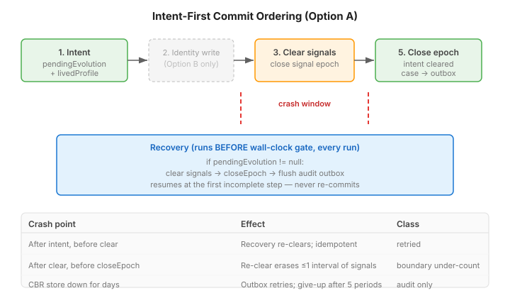

# The phase that replaced nothing

Continues from [The pull that replaced the push](2026-11-18-mdp02-the-pull-that-replaced-the-push.md).

`PersonalityEvolutionOrchestrator` had two public methods and zero production callers. `DispositionEvolutionPhase` replaces it — not by fixing it, but by moving personality evolution out of the orchestrator model entirely and into the consolidation scheduler that already runs MindMap maintenance, experience graduation, CAPS settling, and goal resolution. The phase sits at `@Priority(50)`, after the PID-5 deformation phase at 46 and after all personality-reading phases. It evaluates every agent's Jungian disposition profile once per reflection period.

## Why a consolidation phase and not a tick participant

The original orchestrator assumed personality evolution was a per-tick operation: observe an interaction, record a signal, check if a transition is due. The problem is that the check is expensive. `DispositionHealth.probe()` calls the Eidos signal store, computes effective weights, checks four evaluation rules, and runs vocabulary-generic shadow resolution. Running that on every cognitive tick — hundreds of times between consolidation runs — wastes cycles on a process that only needs to fire once per 24-hour period.

The consolidation scheduler already has the right cadence. It runs periodically, iterates tenants and agents, and each phase gets `run(tenantId, subgraphPriority)`. The phase reads the reflection ledger from the state store, checks whether a full period has elapsed since the last reflection, and skips the agent if not. When a reflection is due, it drains accumulated signals, probes the descriptor, evaluates, and commits or defers. Per-agent isolation means one agent's exception never blocks another.

## Intent-first commit ordering

The hardest part of the design was getting the commit order right. A JPAF transition changes the agent's lived disposition profile — the dominant/auxiliary function swap that defines which Jungian cognitive functions lead behaviour. If the process crashes between writing the new profile and clearing the old signal epoch, the next reflection will probe the new identity against stale counts and could commit a spurious second transition.

The solution is intent-first ordering. Step 1 writes the intent (what transition is about to happen) and the lived profile together in a single state transition. Step 3 clears the signal epoch. Step 5 closes the epoch — removing the intent and recording the transition for audit. Recovery runs before the wall-clock gate on every consolidation pass, checking for a pending intent. If one exists, the previous commit is still in flight; recovery clears signals and closes the epoch without re-probing.

The crash window between clear and closeEpoch costs at most one consolidation interval of signals — the activations recorded between that crash and the next run. Those activations sit at the epoch boundary the transition is closing, so the under-count is bounded and accepted.

## The lived profile as store of record

Under option A of the design spec, neocortex owns the lived profile. When Eidos evaluates a disposition and returns `Evolved`, the phase commits the new profile as a `LivedProfile` on the `PersonalityState` — not to the Eidos identity store. `EffectiveCognitiveDefaults` pulls the lived profile lazily via `compositionVersion`-keyed freshness: when the personality state service bumps its composition version, the next `forAgent()` call re-derives from the composed descriptor without any explicit publication step.

This means the Eidos `AgentDescriptor` always carries the authored identity — what the agent was designed to be. The lived profile represents what experiential pressure has shaped it into. `EidosCognitiveProfileBridge.livedDescriptor()` composes the two at probe time, using the authored fingerprint to detect whether the lived profile was built against the current authored identity or a stale one.

## Rate bound and oscillation

Without a rate bound, the transition rate depends on traffic. Under default Eidos preferences, a dominant/auxiliary swap needs about 4 retained auxiliary activations, achievable in a single busy period. An unregulated agent could oscillate between profiles at every reflection.

`minTransitionInterval / relationalComplexity` caps committed transitions. At the default of 30 days and rc = 1.0, an agent can transition at most once per month. The `relationalComplexity` scaling means agents with richer social contexts (higher rc) transition faster — they accumulate more signal per period — while agents with rc = 0 are evolution-disabled entirely: no probe, no journal entry, no signals recorded.

The rate bound gates only *when* an Evolved result is committed. It doesn't filter what the agent experiences or accumulates. Signals keep arriving and decaying between transitions. When the bound lifts, the probe evaluates the full accumulated state, not just what arrived since the last transition.

## Authored edit reconciliation

What happens when someone edits the authored profile while a lived profile is active? The phase fingerprints the authored descriptor's disposition profile on every due reflection. If the fingerprint changes:

1. First sight: the new fingerprint is recorded, and a reauthoring marker is set.
2. The reauthoring stays unconfirmed for one reflection period — giving the author time to revert.
3. If confirmed: the lived profile goes dormant. The authored identity takes precedence. Signals reset to the new epoch.
4. If reverted within the period: the reauthor marker clears, the lived profile reactivates, and the agent continues from where it was.

The key constraint: an Evolved outcome is deferred while a reauthoring is unconfirmed. We don't commit a transition against an authored profile that might be reverted within hours.

## What was deleted

`PersonalityEvolutionOrchestrator`, `EvolutionTick`, `PersonalityEvolutionConfig`, `DefaultPersonalityStateSource` — 401 lines removed. The orchestrator's test file had five scenarios (stable, drifting, halted, evolved, dampened) that the new phase's tests cover with better crash-safety and state-management testing. The halt concept is gone entirely — replaced by the rate bound, which achieves the same oscillation prevention without blocking signal accumulation.

The queue that tracked this work across two issues (#1060 and #1118) is now drained. Nine issues landed on a single branch, from pre-existing test failures through the design review, foundation types, pull model, signal recording, PID-5 promotion, and finally the full JPAF evaluation pipeline. Work-end will close them all in one pass.
