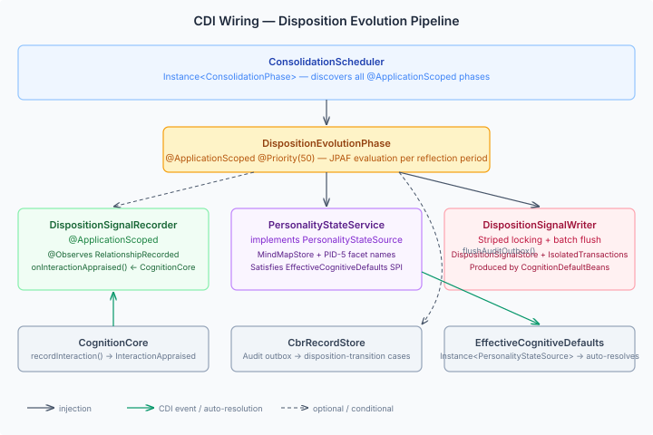

# The build that was already broken

Continues from [The phase that replaced nothing](2026-11-18-mdp03-the-phase-that-replaced-nothing.md).

The previous session built `DispositionEvolutionPhase` — a full JPAF evaluation pipeline with intent-first commit ordering, lived profile composition, and rate-bounded transitions. All tested. Zero production callers. The phase was a pure Java class with no CDI annotations: invisible to the consolidation scheduler, uninjectable, unreachable from any Quarkus deployment.

This session plugged it in. Four commits: CDI wiring, a stale-snapshot fix, reversal detection, and the audit outbox.

## The compilation error nobody noticed

The first thing we hit was a build break that predated this session. `DefaultPersonalityStateSource` — a no-op implementation that returned `Optional.empty()` for every query — had been deleted in #1118 when `PersonalityStateService` absorbed its role. But the reference in `EffectiveCognitiveDefaultsProducer.create()` was still pointing at the deleted class.

```java
stateSource != null ? stateSource : new DefaultPersonalityStateSource()
```

The module compiled on incremental builds because the stale `.class` file sat in `target/`. A `clean compile` failed immediately. The fix was a lambda: `(t, a, now) -> Optional.empty()`. But the real fix was making `PersonalityStateService` CDI-discoverable — once it's an injectable bean implementing `PersonalityStateSource`, the ternary never reaches the fallback.

This is the kind of gap that static analysis won't find and unit tests won't catch. The producer calls a constructor for a type that doesn't exist, but no test exercises the CDI producer path. The incremental build masks the error. It sits there until someone runs `clean compile` and wonders why cognitive-index won't build.

## The dual-constructor pattern

`DispositionEvolutionPhase` needs nine dependencies. Some of them — `DispositionHealth`, `DispositionEvolution`, `AgentRegistry` — come from Eidos and might not be on the classpath in every deployment. Others, like `CbrRecordStore`, are optional features. The CDI wiring pattern for this:

```java
@ApplicationScoped
@Priority(50)
public class DispositionEvolutionPhase implements ConsolidationPhase {

    @Inject
    public DispositionEvolutionPhase(
            DispositionHealth health,
            DispositionEvolution evolution,
            AgentRegistry agentRegistry,
            Instance<CbrRecordStore> cbrStore,
            EffectiveCognitiveDefaults effectiveDefaults,
            PersonalityStateService stateService,
            DispositionSignalWriter signalWriter,
            DispositionEvolutionConfig config,
            Clock clock) {
        this(health, evolution, agentRegistry,
             cbrStore.isResolvable() ? cbrStore.get() : null,
             effectiveDefaults, stateService, signalWriter, config, clock);
    }

    DispositionEvolutionPhase(/* same params, no Instance<> */) {
        // direct assignment — used by tests
    }
}
```

The `@Inject` constructor resolves optional dependencies via `Instance<>` and delegates to a package-private constructor that tests use directly with mocks. The consolidation scheduler discovers it through `Instance<ConsolidationPhase>` because `@ApplicationScoped` makes it a CDI bean. `@Priority(50)` controls ordering — after PID-5 deformation at 46, after all personality-reading phases.

The same pattern applied to `DispositionSignalRecorder`, with `Instance<TraitPressureSource<?>>` collecting all pressure source beans. The `TraitPressureSource` implementations — `RelationshipPressureSource` and `InteractionPressureSource` — needed their own `@ApplicationScoped` annotations for CDI to find them.



## The outbox that records transitions

Disposition transitions are rare — once per month at most, gated by the rate bound. When one happens, it represents a meaningful shift in an agent's cognitive profile. Losing that record is not acceptable; replaying it is cheap. Classic at-least-once semantics.

The audit outbox sits on `ReflectionLedger`. When `commitEvolution()` writes the pending evolution and `closeEpoch()` moves it to the outbox, the entry carries the transition's case features: previous and new labels, the trigger type, and the authored descriptor fingerprint. `flushAuditOutbox()` runs twice per reflection — once after recovery (to drain entries left by a crash), once after the main evaluation path.

Each attempt either succeeds (CBR record stored, entry removed) or fails (attempt counter incremented, next retry delayed by `reflectionPeriod * attemptCount`). After five failures, the entry is dropped with a `DispositionTransitionAuditFailed` journal entry. The give-up is deliberate: an audit outbox that grows without bound becomes its own availability risk.

The CBR cases enable future retrieval of similar disposition transitions. When an agent drifts toward a profile that another agent already traversed, the transition history is searchable: what happened last time someone moved from TI-NE to NE-TI? Did it stick? Did it reverse?

## Reversal detection

Speaking of reversal — the phase now tracks A→B→A oscillation patterns. The `ReflectionLedger` already carried `lastTransitionFromLabel` and `reversalStreak` fields from the design; they just weren't wired. The logic is in `commitEvolution()`:

If the new transition's target label matches the previous transition's source label, the agent is reversing. Streak increments. If the target is something new, streak resets to zero. At streak ≥ 2, the phase journals `DispositionReversal` with the streak count.

A reversal streak of 2 means the agent went A→B→A→B — four transitions, each reversing the previous. At the default 30-day rate bound, that's four months of oscillation. The journal entry doesn't block anything; it's a signal for monitoring. An agent oscillating at that rate is either experiencing genuinely conflicting environmental pressure, or the JPAF evaluation thresholds need tuning.

## What this connects

The `PersonalityStateService` producer is the linchpin. It's a `@Singleton` with `MindMapStore` and configurable PID-5 facet names (13 defaults, matching the full biographical pipeline). Because it implements `PersonalityStateSource`, once CDI produces it, `EffectiveCognitiveDefaultsProducer` picks it up via `Instance<PersonalityStateSource>` — no explicit registration, no cross-module wiring. The type system does the routing.

`DispositionSignalRecorder` connects the signal-recording side. It `@Observes RelationshipRecorded` CDI events directly. For interaction signals, `CognitionCore.recordInteraction()` derives a quality signal from the current mood state and calls the recorder via the `CognitivePipelineBuilder` wiring. Every interaction gets appraised; the recorder filters by disposition relevance and queues activations through `DispositionSignalWriter`.

Four commits. The phase that had zero production callers now sits in the consolidation scheduler, records signals from every interaction, persists transitions to CBR, and monitors for oscillation. The next session will add E2E tests that run the full pipeline through a `@QuarkusTest` container.
