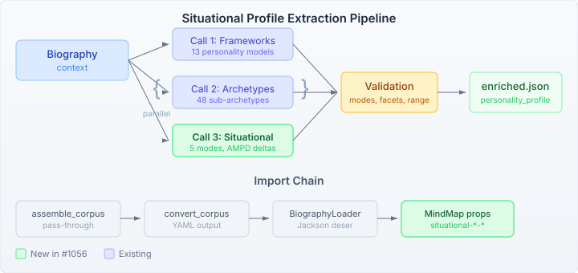

The situational personality system runs on delta tables. Five modes — stress, flow, collaborative, competitive, hierarchical — each with a set of AMPD facet shifts that describe how personality deforms under that condition. Until now, those tables came from archetype family defaults: estimated values, identical for every Creator, every Hero, every Caregiver. The character's biography — the actual documented evidence of how they respond under pressure — played no role.

That gap matters more than it looks. A generic Creator-under-stress profile says Emotional Lability goes up and Withdrawal goes up. Frida Kahlo under stress did something different: Emotional Lability went up, yes, but Withdrawal went *down*. She painted more. She engaged more. The generic profile gets the first facet right and the second one backward. When the system uses that profile to modulate personality during appraisal, it pushes the character in a direction contradicted by everything we know about her.

## Extraction as a third parallel call

The biographical extraction pipeline already ran two parallel LLM calls: one for personality frameworks (OCEAN, MBTI, Enneagram, AMPD, eleven others), one for archetype identification (Hartwell & Chen taxonomy, 48 sub-archetypes). The situational profile is a natural third call — same biographical context, different question.

The prompt asks the LLM to identify how the subject's AMPD facets shift under each mode, grounded in specific biographical episodes. The key instruction: "Only include modes where the biography provides clear evidence of personality shift. Omit modes entirely if biographical evidence is insufficient." A character with no documented competitive interactions gets no competitive profile. The runtime falls back to the archetype family default for that mode. This is correct — partial evidence should produce partial profiles, not speculative ones.

## Delta validation

The LLM returns integer deltas in [-50, +50] on the 0-100 AMPD scale. The validation layer enforces this:

- Mode must be one of the five valid modes
- Facet names must match the AMPD canon (13 facets, kebab-case)
- Deltas outside [-50, 50] are clamped with a warning
- Zero deltas are stripped (no shift = omit)
- Deltas above 30 trigger a "large delta" warning — not rejected, but flagged for the extraction audit

Duplicate modes are rejected. Invalid facet names are rejected. The validation is strict enough to catch LLM hallucinations but permissive enough to accept legitimate extreme shifts (a delta of 40 for Emotional Lability under stress is unusual but defensible for some subjects).

## The import chain

The extraction output flows through four stages:

1. **enriched.json** — the extraction script writes `situational_profiles` as a sibling of `frameworks` and `archetypes` inside `personality_profile`
2. **engram.json** — `assemble_corpus.py` copies the whole `personality_profile` dict. No change needed — automatic pass-through
3. **personality-profile.yaml** — `convert_corpus.py` now explicitly passes through `situational_profiles` to the per-type YAML output
4. **MindMap node properties** — `PersonalityProfileHandler` writes `situational-<mode>-<facet>: <delta>` with `situational-<mode>-provenance: biographical`

The property naming convention is deliberate: `situational-stress-anxiousness: 15` stores the raw extraction output. The downstream eidos bridge (a follow-up issue) will convert kebab-case to title-case via `AmpdFacets.canonicalise()` and build `SituationalProfile(mode, shifts, "biographical")` records. The import layer stores facts; the bridge layer converts to eidos types.

## Why provenance matters

Every situational profile carries a provenance string: `"biographical"` for extracted profiles, `"estimated"` for archetype family defaults. The runtime already supports this — `SituationalProfileDefaults.forFamily()` returns profiles with provenance `"estimated"`. When the biographical pipeline populates per-character profiles with provenance `"biographical"`, the runtime prefers them over defaults.

This isn't just metadata. It's a quality signal. An estimated profile says "Creators probably respond this way." A biographical profile says "Frida Kahlo specifically responded this way, based on documented episodes." When the system is uncertain whether to trust a situational modulation, provenance tells it how much weight to give the delta.

## The shadow that isn't a label

The companion issue (#1058) asked: what does a settled CAPS attractor pattern mean in identity terms? A "withdraw" attractor for a Creator means something different than for a Hero. The initial instinct was a shadow taxonomy — static labels mapping (archetype, mode, attractor) to named shadows. "Creator under stress → obsessive perfectionism."

We decided against it. The system already computes per-facet displacements in real time. The personality state after modifiers is the shadow — not a label, but the actual numeric reality of how this character's personality has shifted. The question is not "what shadow archetype is this?" but "what does this character look like right now, given everything that's happened?"

The design for #1058 enhances the prompt rendering to show the displaced personality state directly — which facets shifted, by how much, boosted by relevance to the current situational mode and active CAPS attractor. Combined with the character's archetype family, the LLM has enough to generate identity-coherent behavior. No taxonomy needed. The shadow is emergent.

The relevance scoring is configurable: `maxFacets`, `minDisplacement`, `modeRelevanceBoost`, `attractorRelevanceBoost`. A facet that is both displaced AND characteristic of the active mode ranks higher than one that's displaced but unrelated. The tuning knobs exist because we don't yet know the right balance — this is build-and-learn territory.

## What changed

| Issue | What it did |
|-------|------------|
| #1056 | Biographical extraction of per-character situational profiles |
| #1058 | Shadow narrative frame design — emergent from displaced state, not static taxonomy |
| #1157 | Follow-up: bridge MindMap properties to eidos SituationalProfile records |
| #1158 | Follow-up: re-extract existing biographies with situational data |

The situational personality system had runtime mechanics. Now it has a source — per-character, evidence-grounded, provenance-tracked. The shadow frame that interprets those shifts will emerge from rendering the data to the LLM, not from a lookup table.r
