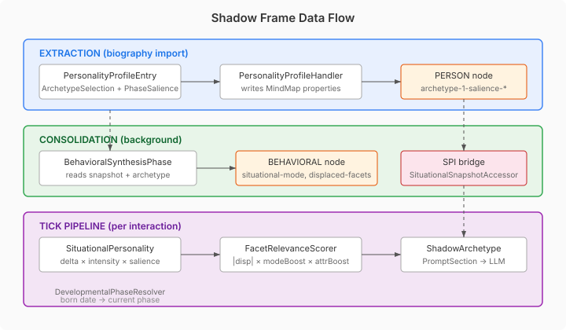

The situational personality system could already detect when a character was under stress and shift their AMPD facets accordingly. What it couldn't do was explain that shift in identity terms, or account for the fact that the same person responds to stress differently at twenty than at fifty.

Two changes today close both gaps. The first annotates behavioural attractors with the situational context in which they formed — the shadow narrative frame. The second makes archetype salience phase-dependent, so the Creator archetype that dominated Frida's childhood can fade as the Sage emerges in later life.

## The circular dependency problem

The shadow frame needs `BehavioralSynthesisPhase` (in `mindmap-intelligence`) to read the situational personality snapshot at attractor formation time. The snapshot lives in `SituationalPersonalityParticipant` (in `cognition`). The dependency arrow points the wrong way — `cognition` depends on `mindmap-intelligence`, not the other way around.

Claude proposed the standard platform pattern: a `@FunctionalInterface` SPI in `cognition-api` (which both modules depend on), with a `@DefaultBean` no-op and a CDI producer in `cognition` that reads from `PersonalityStateService`. The producer overrides the default when the cognition module is on the classpath. When it isn't, attractor creation proceeds without situational annotation. No new module, no new dependency.

This is the same bridge pattern we use for `SituationalSnapshotAccessor` throughout the platform — a functional interface in the API module, a real implementation in the runtime module, graceful degradation everywhere else. The pattern works because CDI's `@DefaultBean` mechanism makes the no-op invisible to consumers that don't need it.

## What attractor nodes carry now

Before today, a behavioural attractor node in the BEHAVIORAL subgraph carried mechanical data: which CAPS output node it represents, how strong it is, what experiences fed it. After today, it also carries:

| Property | Value | Source |
|----------|-------|--------|
| `situational-mode` | STRESS, FLOW, etc. | Active mode from SituationalPersonalitySnapshot |
| `situational-intensity` | 0.72 | Mode intensity at formation time |
| `displaced-facets` | anxiousness:0.15,emotional-lability:0.12 | Top displaced AMPD facets |
| `archetype-family` | creator | PERSON node archetype-1-family |

The displaced-facets string is a compact representation: facet name and displacement magnitude, sorted by absolute value, capped at eight entries. The formation context stays on the node permanently — when the prompt renderer reads attractors later, it has the identity context to explain what this behavioural tendency means.

## Relevance-ranked facet rendering

The old `ShadowArchetypePromptSection` rendered "3 personality traits have shifted from baseline." A count with no detail. The full displaced personality state was available on the snapshot but discarded.

The new renderer uses `FacetRelevanceScorer` to rank which displaced facets to show:

```
relevance = |displacement| × modeBoost × attractorBoost
```

A facet gets `modeBoost` (1.5×) if it appears in the active mode's situational profile — anxiousness under stress is characteristic, so it ranks higher than grandiosity under stress. A facet gets `attractorBoost` (1.3×) if the dominant behavioural attractor correlates with it — the "withdraw" attractor correlates with withdrawal and anxiousness. The boosts stack multiplicatively.

The result: instead of a bare count, the prompt now says what shifted, by how much, in which direction, and whether that shift is characteristic of the current state. The archetype family name anchors it in identity: "You are a Creator. These shifts are your current felt reality."



## Temporal archetype salience

The archetype model currently assigns static ranked archetypes. Frida is a Creator first, a Rebel second. That ranking stays constant regardless of where she is in her life. But biographical evidence tells a different story — the Creator archetype dominated her childhood and adolescence (painting as self-expression from age six), while the Rebel emerged strongly in early adulthood (political activism, the Communist party, the Mexico–Detroit confrontation).

The new `PhaseSalience` record on `ArchetypeSelection` captures this:

```
archetype-1-salience-childhood=0.80
archetype-1-salience-adolescence=0.75
archetype-1-salience-early-adulthood=0.60
archetype-1-salience-adulthood=0.40
```

The extraction pipeline asks the same question it already asks for archetype ranking — "which archetype was most salient in each life phase?" — alongside evidence from the biography. The weights are written as MindMap properties on the PERSON node, alongside the existing archetype-family and archetype-adjectives properties.

I considered three storage options: individual properties, a serialized string, or a dedicated SQLite table. For 12 values per agent (3 archetypes × 4 phases) that change only at import time and are read-only at runtime, individual properties won. They follow the existing pattern, need no parsing, and can be cached by `CognitiveDefaults` after first read.

## The modulation formula

At tick time, `SituationalPersonalityParticipant.computeCompositeDelta()` already applies `delta × intensity` to scale a mode's facet shifts by how strongly that mode is currently detected. The phase salience adds one more multiplier:

```
composite[facet] += delta × intensity × phaseSalience
```

`DevelopmentalPhaseResolver` computes the agent's current phase from `lifecycle.born` on the PERSON node. Phase boundaries match the existing `FormativeTimestampGenerator` conventions: 0–12 childhood, 13–17 adolescence, 18–25 early adulthood, 26+ adulthood. When no born date exists, the resolver returns "adulthood" — a safe default for agents without biographical birth data.

The provenance string on each `SituationalProfile` tells the resolver which archetype family the profile came from. Family defaults carry `"family-default:CREATOR"`, per-character profiles carry `"biographical"`. For biographical profiles, the salience comes from the primary archetype.

The multiplicative formula means a less-salient archetype still contributes — just at reduced intensity. Frida-at-fifty with Creator salience 0.4 still responds to stress with the Creator pattern, but at 40% of the intensity she'd have shown at twelve. The Sage pattern (now at 0.6 salience) dominates. No thresholds, no switching — the transition is smooth.

## What this opens up

The shadow frame and temporal salience work together. An attractor node formed during childhood carries `archetype-family=creator` and `situational-mode=STRESS` with a high salience. The same attractor formed during adulthood carries lower salience for Creator and potentially different displaced facets reflecting the Sage's stress response. The narrative identity layer (#599) will read these annotations to understand not just what behavioural tendencies exist, but which archetype they express and how that expression has shifted over the life course.

The temporal dimension also feeds back into the consolidation pipeline. `BehavioralSynthesisPhase` already passes `developmental-period` as metadata to the CAPS classifier. With per-phase archetype salience, the classifier's context now includes which archetype was dominant when the formative experience occurred — not just what happened, but through which identity lens.
