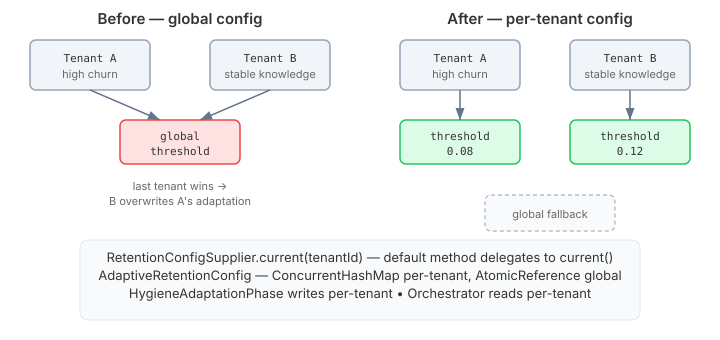

# The Tenant That Tuned Everyone

The hygiene adaptation phase (#1119) shipped with a known gap: `AdaptiveRetentionConfig` held a single `AtomicReference<RetentionConfig>` for the entire system. When the consolidation scheduler processed multiple tenants sequentially, each tenant's eviction pressure calculation overwrote the previous tenant's threshold. The code review noted it. The design spec acknowledged it in D1a. We deferred it because v1 had a single tenant.

That's the kind of deferral that ages badly. The moment a second tenant appears with a different memory profile — one with high churn, another with stable long-term knowledge — the adaptive system does the opposite of adapting. It oscillates between two tenants' needs, settling on whichever happened to run last.

## The shape of the fix

The fix itself is small. `RetentionConfigSupplier` gains a default method:

```java
default RetentionConfig current(String tenantId) {
    return current();
}
```

`AdaptiveRetentionConfig` swaps a single `AtomicReference` for a `ConcurrentHashMap<String, RetentionConfig>` per tenant, with the original atomic reference as a global fallback. `HygieneAdaptationPhase` writes per-tenant. `MemoryHygieneOrchestratorImpl` reads per-tenant. Eight files changed, 136 additions, 24 deletions.



The interesting part is not the fix but the design decision it embeds. The default method on the SPI means every existing `RetentionConfigSupplier` implementation — including lambda expressions like `() -> RETENTION` in tests — continues working without changes. No callers break. No test doubles need updating. The per-tenant path is opt-in at the implementation level while being transparent at the consumption level.

This is the backward-compatible SPI extension pattern that Java's default methods were designed for, and it's one of the few cases where I think the pattern genuinely earns its complexity. The alternative — adding `tenantId` to the abstract method — would have forced every implementation to change, including the lambda in `MemoryHygieneOrchestratorImplTest` that has nothing to do with tenancy.

## The builder that forgot two fields

The second fix (#1147) was smaller but more instructive. `EidosCognitiveProfileBridge.livedDescriptor()` rebuilds `AgentDisposition` via a builder, and the builder chain listed 10 of 12 fields. It omitted `.ampdFacets()` and `.situationalProfiles()`. The sibling method `livedDisposition()` — written at the same time, doing the same thing — included both correctly.

This is the kind of bug that builder APIs make easy to introduce and hard to catch. The builder compiles fine with any subset of fields. The defaults are `List.of()` — empty, not null — so nothing throws at runtime. The only caller currently works around it by calling `LivedComposition.profile()` directly and preserving all fields itself. The bug is silent until someone calls `livedDescriptor()` expecting a complete disposition and gets a silently truncated one.

The fix is two lines. The lesson is worth more: when a builder has N fields and you're copying M of them, the M you chose to list tells you nothing about whether M equals N. Builder APIs that compile with any subset of fields need a different kind of safety — exhaustiveness checking at the call site, or a copy constructor that can't miss fields. Java records with `withX()` methods avoid this entirely because they start from a complete copy. The builder pattern trades field-level safety for construction flexibility, and sometimes that trade costs you two missing fields that nobody notices for months.

## What this opens up

The per-tenant config now gives `HygieneAdaptationPhase` a genuinely independent control loop per tenant. A tenant with volatile, high-churn memory gets a lower retention threshold — fewer memories evicted — while a tenant with stable, long-term knowledge can maintain a higher bar. The step-based controller already had per-tenant state tracking (`previousSummaries`, `previousConfigs`), so the oscillation-suppression logic works correctly without changes. The only thing that was global was the output — writing to a shared config that every tenant's tick would read back.

The `tenantConfigs` map grows without bound. For a cognitive system with a handful of tenants this is fine. Per-agent adaptation — the next level of granularity, where one agent's poor retention in an otherwise healthy tenant gets independent tuning — is deferred. That would change the config dimension from `Map<String, RetentionConfig>` to a two-level map, and I'd want evidence from production memory profiles before adding that complexity.
