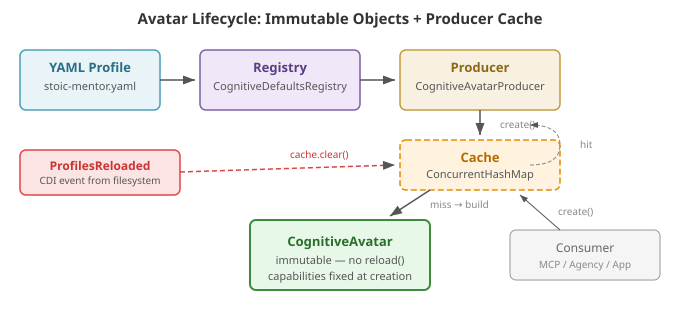

# The Avatar That Didn't Need reload()

The cognitive-runtime module shipped last session with the composition root and six capabilities. This session was supposed to be follow-up housekeeping: missing tests, CDI wiring, two more personas. The interesting discovery was in the item I closed without writing any code.

## The immutability insight

I'd filed #1239 — "avatar hot-reload via CognitiveProfilesReloaded" — expecting to add a `reload(CognitiveDefaults)` method to `CognitiveAvatar`. The avatar holds a `BriefingConfig` and a `CognitiveDefaults`, both set at construction. When the YAML profile changes on disk, the avatar should pick up the new briefing text.

The obvious approach is a `reload()` that re-initialises the capabilities with updated config. But `CognitiveAvatar` was designed immutable — `List.copyOf(capabilities)` in the constructor, no setters, no mutable state. Adding `reload()` would mean either making it mutable (breaking the thread-safety guarantee) or rebuilding the capability list inside a synchronised block (complexity for a problem that shouldn't exist).

The `CognitiveAvatarProducer` I'd just built for #1235 already solves this. It caches avatars in a `ConcurrentHashMap` keyed by `tenantId:agentId`. It observes `CognitiveProfilesReloaded` — a CDI event fired when `CognitiveProfileWatcher` detects filesystem changes — and clears the entire cache. Next `create()` call builds a fresh avatar from the updated profile. The old one becomes garbage.

No reload. No mutable state. No synchronisation. The lifecycle is: create, use, discard. The producer owns the lifecycle; the avatar is a value.

I closed #1239 without writing a line of code. The issue was predicated on the avatar needing to be long-lived and updated in place. Once the producer handles creation and cache invalidation, the avatar doesn't need to know about reload at all.

## The disposition gap

The two personas from last session — stoic-mentor and bold-strategist — had briefing text and behavioural defaults but no `descriptor.disposition` axes. That meant `DispositionCapability` returned null for them. The `CognitiveDerivationEngine` couldn't derive personality weights, CBR strategy defaults, or social cognition settings — the whole derivation pipeline that turns five disposition axes into twenty derived configuration values was dark.

The fix was five lines of YAML per persona. But it exposed something worth noting: the persona YAML format makes it easy to ship a "working" profile that's actually incomplete. The briefing renders, the goals render, the temporal awareness renders — everything looks fine until you check whether `DispositionCapability` is contributing anything. A test that asserts `profile.descriptor()` is non-null catches this at the right moment.

## Four personas spanning the disposition space

The library now has four pre-built personas: stoic-mentor, bold-strategist, thorough-planner, and pragmatic-assistant. The design constraint from the echo research is that each persona's echo text must be evocative rather than prescriptive — era1 showed that template-based echo ("Review your personality traits") scored *below* the no-instruction baseline. Each echo was written to invoke the persona's reasoning style without prescribing it.

The four span the disposition axes meaningfully:

| Persona | ruleFollowing | riskAppetite | conflictMode |
|---------|--------------|-------------|-------------|
| stoic-mentor | high | low | collaborative |
| bold-strategist | low | high | competitive |
| thorough-planner | high | low | cooperative |
| pragmatic-assistant | moderate | moderate | accommodating |

Stoic-mentor and thorough-planner share high ruleFollowing but differ in autonomy and conflict mode — the mentor holds to principle, the planner holds to process. Bold-strategist and pragmatic-assistant both favour action but for different reasons — opportunity versus practicality.

## ProfileDescriptorViewSource

The last piece of CDI wiring was `ProfileDescriptorViewSource` — a `@DefaultBean` `DescriptorViewSource` backed by `CognitiveDefaultsRegistry`. Without it, the derivation engine pathways (personality weights, CBR strategy, social cognition, graph structure) only work when the full eidos stack is on the classpath. With it, a deployment using just `cognitive-runtime` can still derive all twenty configuration values from the five disposition axes in the YAML profile.

The `@DefaultBean` annotation is the CDI priority mechanism: when `EidosDescriptorViewSource` from `cognitive-eidos` is present, it wins. When it's absent, the profile-backed source activates. Consumers don't choose; the classpath decides.

## What this opens up

The cognitive-runtime module now has the full wiring story: YAML profiles → registry → producer → cached immutable avatars → prompt sections. A Quarkus app can `@Inject CognitiveAvatarProducer`, call `create("stoic-mentor", tenantId)`, and get a fully-configured avatar with briefing, goals, temporal awareness, memory, entity knowledge, and disposition — all derived from one YAML file.

The composition tests (#1238) are next. The individual capabilities are tested in isolation, but the interaction patterns — multiple capabilities rendering into the same prompt, contention on shared stores, hot-reload with active renders — haven't been validated yet.
