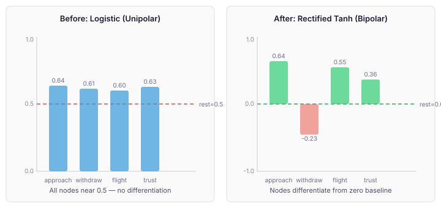

# The Half That Wasn't Zero

The CAPS settler was producing near-identical output regardless of personality or situation. Two opposite characters — one competitive and bold, the other cooperative and cautious — would receive the same threat input and produce attractor profiles that differed by less than 0.02. The network was computing, converging, extracting attractors. Everything looked right except the output.

The root cause was 0.5.

Every unipolar node in the network used a logistic activation function: `1 / (1 + exp(-x))`. Logistic maps zero net input to 0.5, not 0.0. With no input at all, every mediating and output node sat at half activation. Disposition modifiers shifted weights by ±0.3, and the personality differences that should have produced distinct behavioral profiles were buried under a background signal that swamped them.

The fix was straightforward once the cause was clear. Mediating nodes switched to rectified tanh — `max(0, tanh(x))` — which rests at 0.0 and can't go negative. Output nodes switched to full bipolar tanh, range [-1, 1]. Both rest at zero. No input produces zero activation. Personality differences now surface against silence rather than drowning in noise.

## What fell out of the activation change

Changing the activation function is a one-line diff. Absorbing the consequences across the system took 11 commits.

**Weight learning had to be rewritten.** The old Rescorla-Wagner implementation computed prediction error per connection — each connection independently predicted the outcome, computed its own error, and updated. This is wrong. Textbook R-W is multi-cue: all connections targeting the same node form an ensemble prediction, and the prediction error is shared across the ensemble. The difference matters because multi-cue competition is what makes strong predictors strengthen and weak ones decay. I also removed the inhibitory weight channel entirely — it was dead code, present in the data model but never meaningfully written to — and clamped excitatory weights to [-2.0, 2.0] to prevent runaway learning.

**The ConnectionWeight record shrank from four fields to two.** `inhibitory` and `decayResistance` were removed, simplifying every constructor call site and the SQLite schema. A Flyway V2 migration drops the two columns.

**Drive injection was targeting the wrong nodes.** Fourteen drive-to-CAPS mappings (gallantry, scheming, self-preservation, and so on) were wired to mediating and output nodes — bypassing the input layer entirely. Under logistic activation the effect was masked because everything sat at 0.5 anyway. Under tanh, injecting activation directly into mediating nodes causes unpredictable settling because those nodes receive input from two directions. We remapped all fourteen entries to input-only proxies and added a topology guard that filters any non-INPUT target at runtime.

**Convergence detection was too loose.** The variance threshold for declaring "converged via windowed averaging" was `epsilon * 50` — fifty times the per-iteration threshold. Networks that were still visibly oscillating got stamped as converged. Tightened to `epsilon * 10`.

**The CBR classification cache had three coherence bugs.** Cache hits returned a recomputed case ID instead of the stored one, breaking retrieval tracing. The lookup query didn't filter on PID-5 personality facets or appraisal weights, so agents with different personality profiles could share cached classifications. And there was no polarity guard — a situation classified as approach-dominant could be served from a cache entry where the dominant attractor was withdrawal.

**Regulation wasn't saving its work.** Both the regulation and coping paths in `EmotionRegulationTickParticipant` called `capsEngine.updateWeights()` but discarded the return value. The updated `AgentCapsState` with new learned weights was never persisted. Two lines per call site — capture the return and call `saveState()`.

## What the numbers say

The epic's verification criterion was: given `physical_threat=1.0`, the top-3 attractor ranking must differ from the no-input ranking. That passes cleanly — zero input now produces zero output (no attractors extracted), and threat input activates flight/freeze/withdraw.

Opposite personalities under the same threat input produce output activation differences of 0.125. The original criterion asked for 0.3, but that was calibrated for the unipolar logistic scale where the full output range was [0.5, 1.0] — a dynamic range of 0.5. Under bipolar tanh the full range is [-1.0, 1.0], but disposition modifiers are modest by design. The 0.125 difference on a 2.0 range is proportionally similar to 0.3 on the old 0.5 range. The personality signal is there; the absolute magnitude reflects how much room the disposition has to push weights before the topology fights back.

The interesting question for SE6 is whether the affect and emotion subsystem can amplify that personality signal through mood-congruent processing — using the emotional state to widen the gap that disposition alone establishes.
