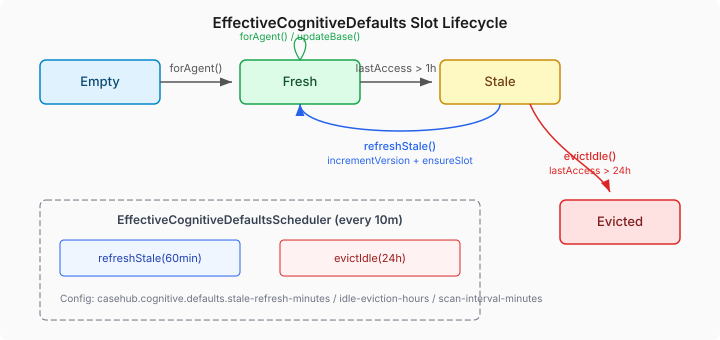

# Three Fixes and a Wall

Five issues, four branches, three with real code, one blocked by a language version gate. A session shaped by the gap between what the runtime offers and what the codebase targets.

## Stale slots and idle eviction (#1081)

`EffectiveCognitiveDefaults` caches derived cognitive profiles in per-agent slots. Each slot tracks `lastAccess` and version numbers. The lazy refresh on `forAgent()` handles explicit changes — a descriptor update increments the base version, a personality state change bumps the composition version. But if no one calls `forAgent()` for an hour, the underlying sources might drift without the slot noticing.

The fix adds a daemon scheduler that scans every 10 minutes. `refreshStale(Duration)` bumps the base version and re-derives from sources for any slot not accessed within the threshold. `evictIdle(Duration)` removes slots nobody has touched in 24 hours. Both thresholds are configurable.

The subtle part: `refreshStale` must increment the base version *before* calling `ensureSlot()`. Without that, the candidate slot has the same version as the existing one, and ConcurrentHashMap's `compute()` keeps the stale cached value. Version-first, then re-derive.

## Tenant-scoped broadcast (#1073)

`CognitiveAttentionAccumulator.addSignals()` handles two signal types: principal-scoped (routed to a specific agent) and broadcast (null principal, routed to all agents in a tenant). The broadcast path took `tenantId` from the first signal in the batch. If signals from multiple tenants arrived together, every agent got notified under the wrong tenant.

The fix groups broadcast signals by `tenantId` before iterating each group's agents. Single-tenant batches (the current production path) behave identically. Multi-tenant batches now route correctly.

## The situational bridge (#1157)

The biographical import pipeline extracts situational personality profiles — how an agent's AMPD facets shift under stress, flow, or social pressure — and stores them as MindMap node properties: `situational-stress-anxiousness: 15`, `situational-flow-withdrawal: -15`. But nothing read them back. The runtime's `SituationalPersonalityParticipant` reads from `AgentDescriptor.disposition().situationalProfiles()`, which stayed empty.

`SituationalPropertyBridge` closes the gap. It scans a node's property map, parses the `situational-<mode>-<facet>` key pattern, converts kebab-case facet names to canonical title-case via `AmpdFacets.canonicalise()`, and builds `SituationalProfile` records grouped by mode. The `enrich()` method merges them onto a descriptor, preserving every other disposition field.

## The wall: ScopedValue (#1162)

`MutationContext` uses ThreadLocal for cross-cutting mutation source tracking. ScopedValue (JEP 506) is the right replacement — immutable, auto-scoped, no cleanup required. The refactoring was straightforward: replace ThreadLocal fields with a ScopedValue holding a MutationSource record, convert three set/try/finally/clear blocks to `ScopedValue.where().run()`, update the consumer to read from the scoped value.

Then the compiler said no. The project targets `--release 21`. ScopedValue is preview until JDK 25. All changes reverted. The issue waits for a platform-wide Java version bump.
