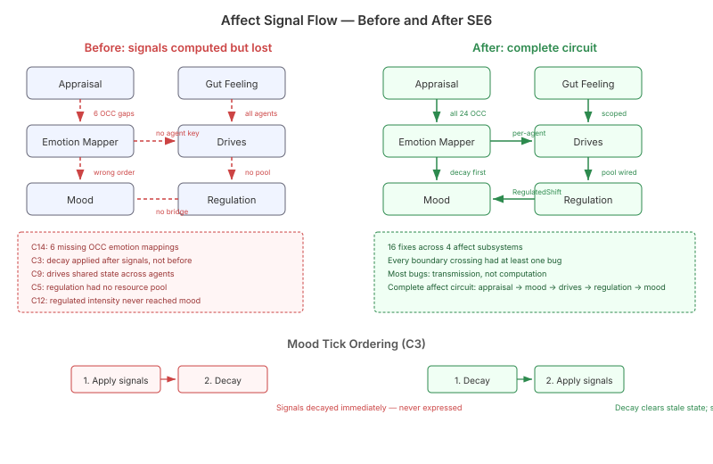

# The Affect That Couldn't Land

The cognitive pipeline had all its affect subsystems wired up. Appraisal ran SEC dimensions through the LLM. The emotion mapper translated SEC patterns into OCC emotions. The mood orchestrator accumulated PAD signals. The drive system computed motivational intensities. The regulation pipeline managed cognitive load. Each subsystem computed its output correctly in isolation.

Agents were emotionally flat anyway.

The review surfaced sixteen bugs. Not one was a computation error. Every single one was a transmission failure — signals that computed correctly but got lost, distorted, or arrived in the wrong order at the boundary between subsystems.

## Mood: order matters more than magnitude

The mood orchestrator had a timing bug that was almost invisible. It applied incoming signals first, then decayed toward baseline. The result: a fresh appraisal signal arrived, got written into the PAD state, and was immediately decayed in the same tick. Strong emotions showed up as barely perceptible shifts.

The fix was mechanical — decay first, apply signals second. Stale state clears before new signals land. But the second-order consequences ran deeper. Goal emotions had been implemented as per-tick deltas (add +0.3 pleasure every tick a goal is active), which meant they accumulated without bound. They should have been set-point biases — shift the target the mood decays toward, not add a force every tick. And the dampening function treated approach and retreat symmetrically, which meant falling from high pleasure used the same curve as rising from low. Asymptotic dampening — approaching the baseline more slowly as you get closer — needed to be direction-aware.

The decay constant itself was wrong. Four hours meant mood barely moved between interactions. Twenty minutes gives affect a half-life that matches conversational rhythm — a strong emotion fades noticeably within a session but doesn't vanish between turns.

The ArrayDeque backing the signal buffer wasn't thread-safe either. ConcurrentLinkedDeque fixed a race where signals from appraisal could be dropped during concurrent tick processing.

## Appraisal: the missing six

The emotion mapper translates SEC dimension patterns into OCC emotions. It had eighteen mappings. It should have had twenty-four. Six OCC emotions — including REPROACH, GLOATING, and HAPPY-FOR — had no SEC-to-OCC mapping at all. An agent could feel the SEC dimensions that corresponded to reproach (low conduciveness + external attribution + high internal standards), but the mapper couldn't name it.

The INTERRUPTION emotion had no intensity cap, which meant a single surprising input could dominate the entire emotional profile. Capping it at 0.3 keeps surprise proportional.

The appraisal weights — per-agent SEC dimension emphasis derived from disposition — were computed by `CognitiveDerivationEngine` but never injected into the LLM prompt. The strategy produced identical appraisals regardless of personality. The habituation hash used `Object.hashCode()` on a list, which isn't stable across JVM runs. Switching to a content-based hash means habituation state survives restarts.

The gut-feeling Layer 2 scan searched affect memories across all agents in the tenant. An agent's gut reaction was influenced by what other agents were feeling. Scoping the scan to the requesting agent's own affect history made gut feelings genuinely personal.

## Drives: identity lost at four boundaries

All four drive sources — curiosity, competence, affiliation, autonomy — stored their state in a shared `Map<String, DriveIntensity>` keyed by drive name. When two agents ran in the same tenant, their drive states overwrote each other. Agent B's high curiosity would replace Agent A's low curiosity. The fix was straightforward: key by agent ID, not drive name.

The personality modulation on drives used `DispositionAxis.position()`, which returns a value in [0, 1]. Drive modulation needs signed semantics — an axis position below 0.5 should dampen, above 0.5 should boost. We added `signedPosition()` to the eidos repo's `DispositionAxis`, mapping [0,1] to [-1,1]. This was the only cross-repo commit in the batch.

Coping drive modulations — the adjustments that emotion regulation applies to drives — were being overwritten on each tick instead of accumulated. A regulation event that reduced curiosity by 0.2 would be replaced, not merged, by a later event reducing affiliation by 0.1. `Map.merge()` with additive combination fixed it.

`DriveAdaptationPhase` had no timestamp cursor — it reprocessed every experience memory on every consolidation run. And intensity recovery after adaptation was multiplicative (multiply by 0.95), which meant recovery slowed as intensity decreased. Additive recovery (add a fixed delta) gives consistent return-to-baseline speed regardless of current intensity.

## Regulation: the circuit that didn't close

The emotion regulation pipeline was the most complete implementation in the codebase — safety gates, valence filtering, intensity dampening, resource pool management. It computed regulated intensities. Those intensities went nowhere.

`EmotionRegulationTickParticipant` needed a `CognitiveResourcePool` to track cognitive load. It was declared as a dependency but never wired via CDI. The participant ran without a pool, which meant load estimation defaulted to zero — regulation never triggered.

When load estimation did run, it counted axis count (always 4) instead of active drives (variable). An agent with one active drive at high intensity looked the same as an agent with all four drives active at moderate intensity. Counting drives whose intensity exceeds the activation threshold gives a signal that actually correlates with cognitive demand.

The safety gate and valence filter were a single pass. If a signal was both dangerous (high intensity) and mismatched on valence (positive signal during negative mood), only one filter applied. Splitting into two tiers — safety gate first, valence filter second — means both constraints are enforced independently.

The final wire: regulated intensity had no path back to the mood system. The regulation pipeline computed a dampened intensity, stored it, and nothing read it. We introduced `RegulatedShift` as a signal type that bridges regulation output back into the mood orchestrator's signal buffer. The affect circuit closes: appraisal produces emotions, emotions shift mood, mood modulates drives, drives feed regulation, regulation feeds back to mood.

## The pattern

Building a cognitive pipeline is a composition problem. Each subsystem has clear inputs and outputs. The abstractions are right. The computation is right. What breaks is the wiring — the dozen places where one subsystem's output has to become another subsystem's input, with the right identity, the right ordering, the right accumulation semantics.

Sixteen fixes, and not one changed an algorithm. Every one changed a boundary.
