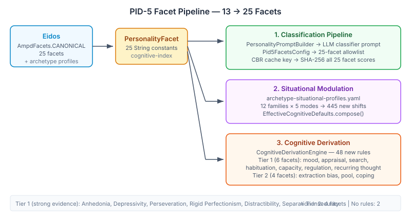

# Giving the Cognitive Engine Its Missing Senses

The CognitiveDerivationEngine has been deriving mood baselines, search budgets, and appraisal weights from personality for months — but it's been doing it with barely half the picture. Thirteen of the PID-5's twenty-five facets were wired; twelve were missing entirely. That's like modelling a face with half the features filled in. You get something recognisable, but it doesn't react properly.

The twelve missing facets include some of the most behaviourally significant in the model: anhedonia (the inability to feel pleasure), depressivity (hopelessness and pessimistic appraisal), perseveration (inability to disengage from ineffective patterns), rigid perfectionism (insistence on flawlessness that blocks flow states), and distractibility (the trait-level attention deficit that shares β=.55 with clinical ADHD measures). These aren't obscure corners of personality theory. They're the facets that most directly shape how someone processes information under pressure.

## The Literature Problem

The design question wasn't which facets to add — it was which ones have empirically demonstrated effects on the cognitive processing parameters the CDE actually models. Face validity isn't enough. "Anhedonia probably reduces pleasure" is obvious; the question is whether the evidence supports specific coefficient magnitudes, and whether the effect is direct or mediated through something else.

I ran a systematic literature review across all twelve facets, searching for empirical studies linking each facet (or its closest well-studied construct) to specific CDE parameters: mood baseline PAD dimensions, Scherer appraisal weights, search budget parameters, habituation rates, working memory capacity, and the rest.

The results split into three tiers:

**Six facets with strong support** — multiple meta-analyses or replicated studies directly measuring the cognitive processing effect. Depressivity's appraisal bias has a path analysis on N=4,859 (Scherer 2022). Distractibility maps to ADHD working memory deficits with effect sizes of d=0.85–1.06 (Martinussen 2005 meta-analysis). Separation Insecurity routes through the attachment anxiety literature, where Downey & Feldman's rejection sensitivity work gives three strong CDE mappings.

**Four facets with moderate support** — fewer studies, often indirect (measuring a related construct rather than the PID-5 facet itself). Restricted Affectivity maps through the alexithymia literature (Trevisan 2019, 66 samples). Eccentricity maps through latent inhibition and overinclusive thinking (Carson 2003).

**Two facets with weak or no support** — Submissiveness (psychometrically poor, λ=−.35 max loading on any PID-5 domain) and Unusual Beliefs (effects are about belief content, not cognitive processing architecture). These enter the facet vocabulary but get no derivation rules.

An interesting finding: the two existing facets with zero CDE rules — Deceitfulness and Attention Seeking — turned out to be more accurately described as *behavioural strategy dispositions* than cognitive processing style modifiers. Deceitfulness gets modest laterality and depth rules from the Machiavellianism cognitive flexibility literature (Bereczkei 2014/2015). Attention Seeking gets a single weak arousal rule. The original decision to leave them without rules was largely correct.

## The Multicollinearity Problem

Adding five Negative Affectivity facets alongside the four that already exist (Anxiousness, Emotional Lability, Hostility, Suspiciousness) concentrates correlated predictors. The CDE's additive model assumes independence — each facet shifts derived parameters by `(score − 0.5) × coefficient`. Stack nine correlated NA facets all at extreme values, and the cumulative shift on shared parameters like `fixationThreshold` could be three times what any single facet produces.

The fix is coefficient sizing. New NA facet coefficients are capped at ±0.1, with one documented exception: Perseveration uses 0.15 on fixation threshold because its mechanistic relationship to fixation is direct, not mediated. Integration tests verify that five NA facets at 0.95 keep fixation above the 0.1 floor and working memory span positive. If future facet additions push past these bounds, a domain-cap mechanism is the follow-up — but the current guard holds.

## Situational Modulation

The derivation rules define what each facet does at rest. The situational profiles define how it shifts under pressure. Stress amplifies nearly every facet in the model — eleven of fourteen show at least moderate evidence for stress-induced intensification. The standout: cognitive/perceptual dysregulation under stress (peritraumatic dissociation, Bremner) produces a delta of +12 on the AMPD scale. Flow has the opposite pattern for self-referential facets — depressivity and distractibility dampen under flow, while eccentricity and perceptual dysregulation actually increase (the absorption-dissociation overlap documented in JAEX 2022).

Competitive social contexts are the strongest social modulator, amplifying seven facets. The most striking: Submissiveness — the facet with no CDE rules — has its strongest evidence precisely in hierarchical social contexts (Tiedens & Fragale 2003 on dominance-submission complementarity). Its situational shift of +15 is the largest in the entire profile set. This facet doesn't affect derived cognitive parameters, but it does affect the classification prompt — a soft influence that shapes how the LLM perceives the personality under hierarchy, without rigid parameter mappings.

## What This Opens Up

Forty-eight derivation rules, 445 archetype profile shifts, and the full PID-5 vocabulary now flow end-to-end through three pipelines: classification, situational modulation, and cognitive derivation. An agent with high anhedonia doesn't just feel less pleasure — it has reduced curiosity weights, shallower search depth, lower effort tolerance, and steeper temporal discounting on past experiences. Under stress, all of those effects intensify. Under flow, the hedonic deficit temporarily lifts.

The CDE is now 1,420 lines. The spec flagged structural decomposition as a follow-up at the 1,500-line threshold. That's close, and each future facet extension will push it further. The monolithic approach — every derivation method in one class, every facet score looked up inline — works while the facet count is stable. It won't scale to the next twelve.
