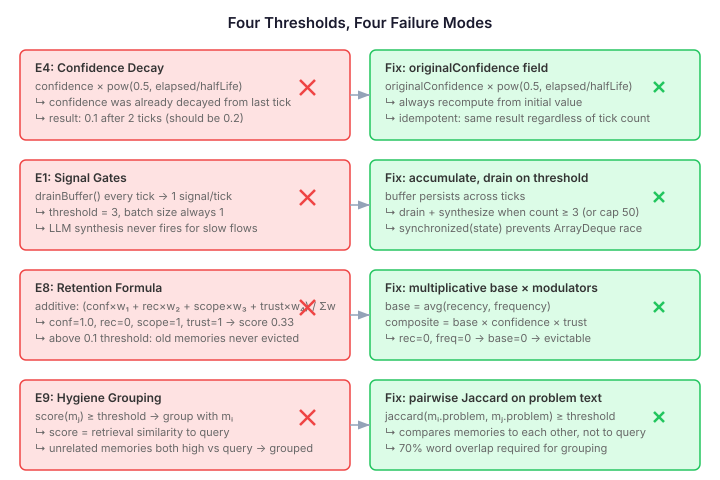

# The Threshold That Never Fired

Continued from [The Affect That Couldn't Land](2026-11-26-mdp02-the-affect-that-couldnt-land.md).

The SE6 session fixed sixteen affect signal transmission bugs. This session started the next sub-epic — SE7: Orchestrators & Higher Cognition — which covers the BDI inference engine, memory hygiene, and goal orchestration. The first four bugs all had the same shape: a threshold existed, the value was reasonable, but the data arriving at the threshold was wrong in a way that made it structurally impossible to fire.

## The confidence that kept shrinking

`MentalModelOrchestrator.decayMap()` applies exponential half-life decay to BDI beliefs. The formula was `s.confidence() * pow(0.5, elapsed / halfLife)`. Simple and correct — if `confidence` were the original value. It wasn't. It was the already-decayed confidence from the last tick.

After one tick at the half-life mark, a belief at 0.8 decays to 0.4. Correct. After a second tick covering the same total elapsed time, the formula should give `0.8 * pow(0.5, 2) = 0.2`. Instead it computed `0.4 * pow(0.5, 2) = 0.1`. Every tick compounded the error.

The fix is an `originalConfidence` field on `AttributedState`. Decay always recomputes from the initial value: `originalConfidence * pow(0.5, totalElapsed / halfLife)`. The result is idempotent — two ticks covering 2 hours produce the same confidence as one tick covering 2 hours. The 7-argument convenience constructor defaults `originalConfidence = confidence`, so every existing construction site works unchanged. Only the decay path uses the 8-argument canonical constructor to preserve the original through updates.

## The buffer that drained before it filled

`MentalModelOrchestrator` and `UserModelOrchestrator` both accumulate signals in a buffer and trigger LLM synthesis when the buffer reaches a threshold (default: 3 signals). The problem: `doTick()` called `drainBuffer()` on every tick, clearing the buffer and passing its contents to `shouldInfer()`. With one signal per tick, the drained text always had exactly one entry. `1 < 3` — threshold never met, signals discarded, LLM synthesis never fires.

The fix: don't drain until the threshold is met. The buffer accumulates across ticks. When it reaches 3 (or the safety cap of 50), drain and synthesize. The `shouldInfer()` method checks accumulated count instead of counting newlines in the drained text.

The review caught something I'd introduced with this fix. Moving `drainBuffer()` outside `synchronized(state)` created a data race — `record()` modifies the same `ArrayDeque` under a different lock. The fix wrapped `shouldInfer()` + `drainBuffer()` back into `synchronized(state)`, keeping the LLM invocation itself outside the lock. The `StrategyLearningOrchestrator` has a different design — it accumulates turns by caseId in a persistent map and matches them when conversation endings arrive. The buffer-drain bug doesn't apply there.

## The floor that couldn't reach zero

`RetentionScore.compute()` used a weighted average of four factors: confidence, recency, scope, and trust. The weights summed to 3.0. An old, never-accessed memory with confidence 1.0 and default trust/scope scored `(1.0 + 0.0 + 1.0 + 1.0) / 3.0 = 0.67`. Well above the 0.1 eviction threshold. The hygiene orchestrator couldn't evict it.

The design decision was clear: recency and frequency should be the base, confidence and trust should be multiplicative modulators. `base = avg(recency, frequency)`. `composite = base × confidence × trust`. When recency is 0 and frequency is 0, the base is 0, the composite is 0, and the memory is evictable regardless of confidence.

Frequency tracking isn't wired yet, so `frequencyWeight` defaults to 0.0 in `RetentionConfig.DEFAULT` — the formula transparently reflects that only recency matters until the tracker exists. Setting the weight to 1.0 while passing 0.0 as the value would have halved every memory's base score, creating a phantom dilution that obscures what the formula actually does.

## The comparison that compared the wrong things

`findSimilarGroups()` in the memory hygiene orchestrator decides which memories are similar enough to consolidate. It compared each candidate's retrieval score against a threshold. The retrieval score measures how relevant a memory is to the original query — not how similar it is to another memory. Two memories about completely different topics can both score 0.8 against a broad query and get grouped for consolidation.

The fix: word-level Jaccard similarity between problem texts, pairwise. `jaccard(mᵢ.problem, mⱼ.problem) >= 0.7` requires 70% word overlap between the memories themselves. The `cognition` module doesn't depend on langchain4j, so embedding-based similarity wasn't available without adding a dependency. Jaccard on word tokens is cheap, dependency-free, and a substantial improvement over comparing against the query.

## What's left

Four bugs down, six to go. The remaining batches cover goal orchestration (tick results discarded by `safeRun`, agent filtering, stale proposal caching), narrative partitioning, personality baselines, and belief revision. Each is a different subsystem, so a fresh session will reason about them more clearly than one carrying compressed context from signal gates and retention formulas.
